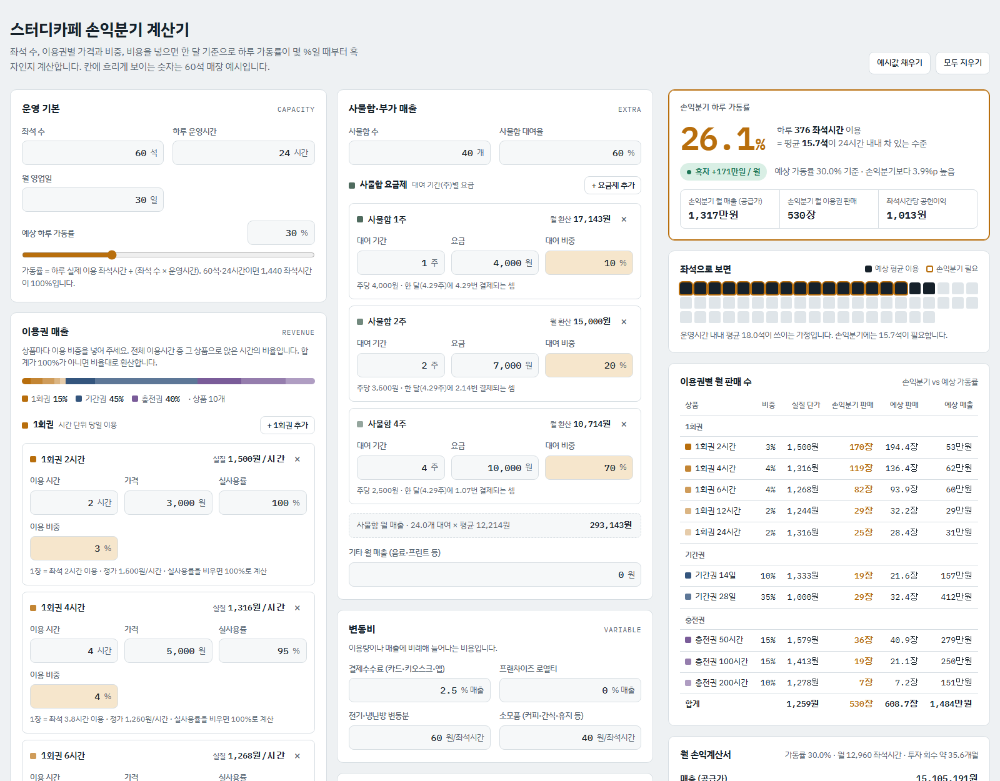

# 스터디카페 손익분기 계산기

좌석 수, 이용권 구성, 변동비와 고정비를 넣으면 **한 달 기준으로 하루 가동률이 몇 %일 때부터 흑자인지** 계산하는 웹 계산기입니다.

- 바로 사용하기: https://studycafe-bep.vercel.app
- 예시값으로 열기: https://studycafe-bep.vercel.app/?example



## 만든 이유

스터디카페는 좌석이 시간 단위로 팔리고, 1회권·기간권·충전권처럼 이용권마다 시간당 실제 단가가 다릅니다. 그래서 "한 달에 얼마를 팔아야 하나"보다 "좌석이 하루에 몇 % 차야 하나"로 보는 편이 운영 판단에 더 직관적입니다. 이 계산기는 입력한 매장 조건을 손익분기 가동률, 필요한 좌석 수, 이용권별 판매 장수로 바꿔 보여줍니다.

## 주요 기능

| 구분 | 내용 |
|---|---|
| 운영 기본 | 좌석 수, 하루 운영시간, 월 영업일, 예상 가동률 |
| 1회권 | 이용 시간(직접 설정), 가격, 실사용률, 이용 비중. 상품을 자유롭게 추가·삭제 |
| 기간권 | 기간(일), 가격, 기간 중 방문 횟수, 1회 평균 이용시간, 이용 비중 |
| 충전권 | 충전 시간, 가격, 유효기간, 소진율, 이용 비중. 미사용 시간은 좌석 없이 남는 매출로 반영 |
| 사물함 | 사물함 수, 대여율, 주 단위 요금제(1주·2주·4주 등)별 요금과 비중 |
| 변동비 | 결제수수료, 로열티(매출 %), 전기·냉난방 변동분과 소모품(좌석시간당 원) |
| 고정비 | 임대료, 관리비, 인건비 등 항목 편집·추가·삭제 |
| 초기 투자 | 투자비와 상각 기간. 감가상각비를 고정비에 넣을지 선택 |

결과 화면에는 다음이 나옵니다.

- 손익분기 하루 가동률과 "평균 몇 석이 운영시간 내내 차 있어야 하는지"
- 좌석 배치도로 본 예상 이용 좌석과 손익분기 필요 좌석
- 이용권별 실질 시간당 단가, 손익분기 판매 장수, 예상 판매 장수
- 월 손익계산서와 투자 회수 기간
- 가동률별 월 영업이익 그래프와 민감도 표

## 계산 방식

```
월 최대 좌석시간      = 좌석 수 × 하루 운영시간 × 월 영업일
월 이용 좌석시간      = 월 최대 좌석시간 × 가동률

이용권 1장이 쓰는 좌석시간
  1회권  = 이용 시간 × 실사용률
  기간권 = 기간 중 방문 횟수 × 1회 평균 이용시간
  충전권 = 충전 시간 × 소진율

이용권 실질 시간당 단가 = 가격 ÷ 1장이 쓰는 좌석시간
좌석시간당 평균 매출    = Σ(이용 비중 × 실질 시간당 단가)

좌석시간당 공헌이익 = 공급가 매출 − 결제수수료 − 로열티 − 좌석시간당 변동비
손익분기 가동률     = (고정비 − 부가매출 공헌이익) ÷ (월 최대 좌석시간 × 좌석시간당 공헌이익)
```

- 판매가에 부가세 10%가 포함된 경우 매출에서 1/11을 빼고 공급가로 계산합니다.
- 사물함 월 매출은 한 달을 30일(약 4.29주)로 보고 주 단위 요금을 월로 환산합니다.
- 매입 부가세 환급, 소득세, 대출 원금 상환, 충전권 선수금의 기간 차이는 반영하지 않았습니다.

## 기술

- HTML, CSS, JavaScript만 쓴 단일 파일(`index.html`)입니다. 빌드 과정과 외부 라이브러리가 없습니다.
- 그래프는 SVG로 직접 그립니다.
- 라이트·다크 모드와 휴대폰 화면을 지원합니다. 넓은 화면에서는 입력 2열과 결과 1열로 나뉩니다.
- 입력값은 사용자의 브라우저(localStorage)에만 저장되고 서버로 보내지 않습니다.
- Vercel CLI로 정적 배포했습니다.

## 실행 방법

`index.html`을 브라우저로 열면 바로 동작합니다.

배포는 Vercel CLI를 씁니다.

```bash
npm i -g vercel
vercel login
vercel deploy --prod
```

## 파일 구조

```
.
├── index.html                  # 계산기 전체 (화면, 스타일, 계산 로직)
├── docs/
│   └── screenshot-desktop.png  # README용 화면
└── README.md
```
